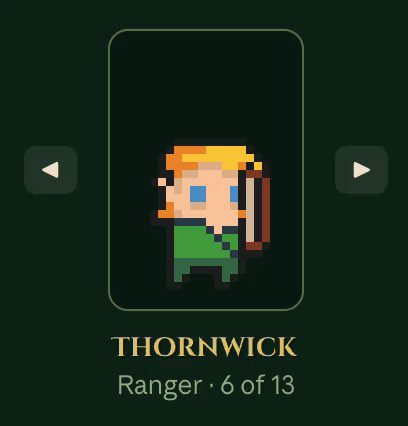
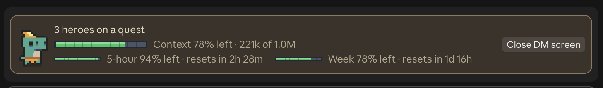
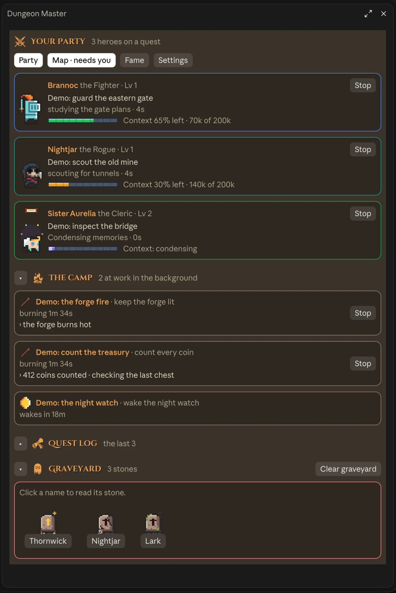
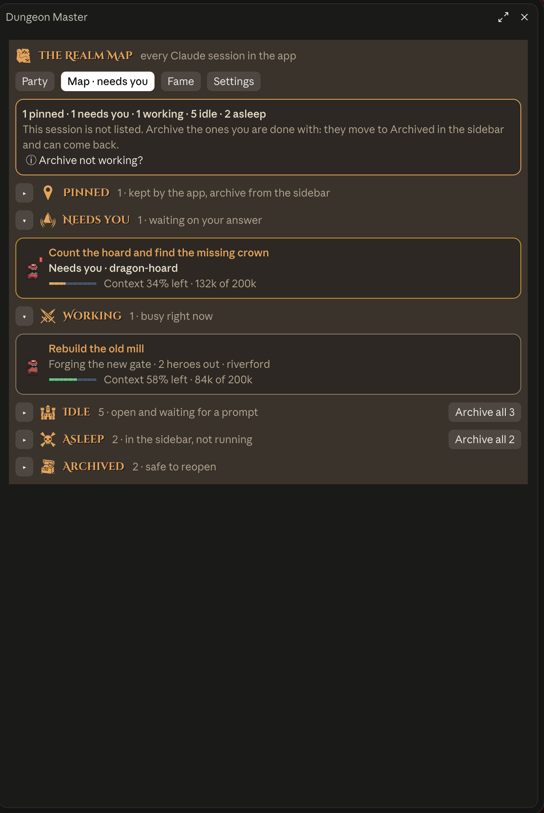
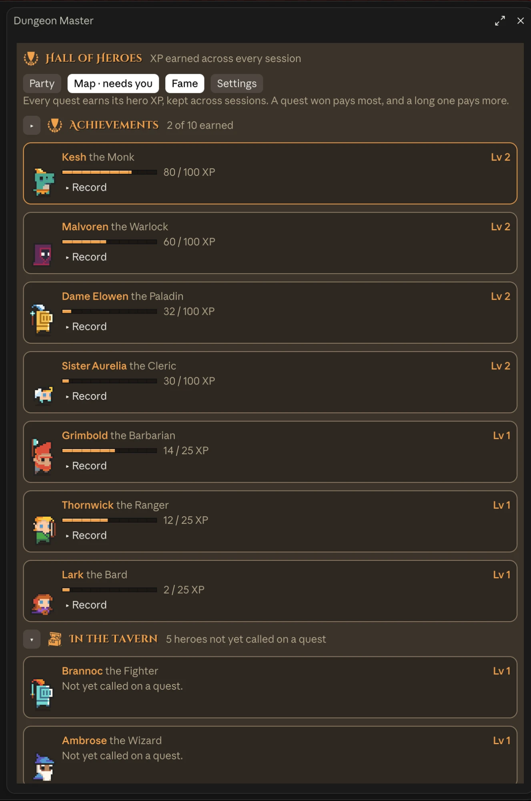
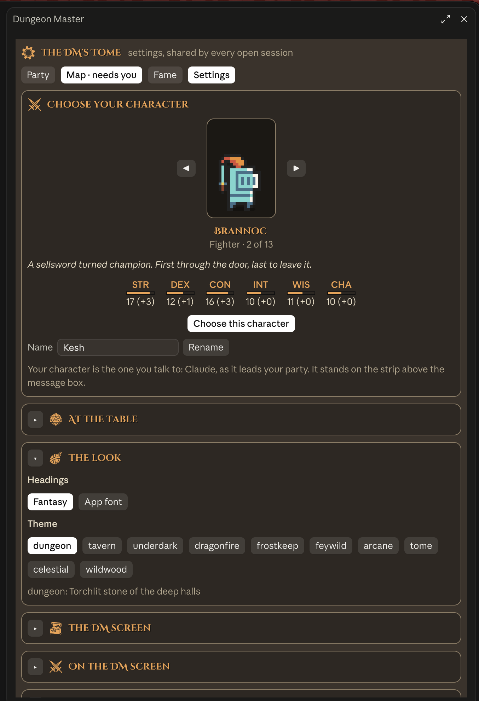
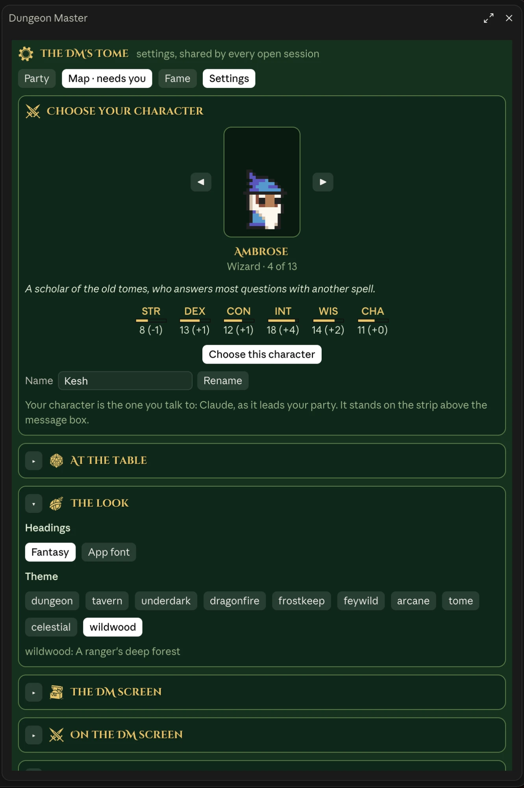
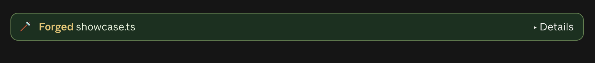

# Dungeon Master

Run Claude Code like a D&D table. Claude is your character at the head of the party; every helper it
sends off on a task is a pixel hero who walks, asks, wins and falls in a side panel: your DM screen.
Everything runs inside the mod: it adds nothing to Claude's prompt, registers no tool for Claude, and costs
no tokens.





| Your Party | The Realm Map |
|:---:|:---:|
|  |  |
| **Hall of Heroes** | **Choose your character** |
|  |  |
| **Ten themes, light and dark** | **Steps told as deeds** |
|  |  |

<sub>Pictures taken in showcase mode (`/dm showcase`): every hero, session and quest in them is made up.</sub>

## What is on the DM screen

| Page | What you get |
|---|---|
| **Your Party** | A hero for every helper Claude sends out (Fighter, Wizard, Rogue and nine more), walking while they work, with what they are doing, how much context they have left, **Stop**, and what it is asking when it needs your permission (you answer in the app's own prompt). Below: **the camp** (commands and monitors left running in the background, with Stop), the **quest log** (a receipt for each of your last turns) and the **graveyard** (finished heroes, their last words and XP). |
| **The Realm Map** | Every Claude session open in the desktop app, sorted into Pinned, Needs you, Working, Idle, Asleep and Archived. **Go** jumps to one, **Archive** (or **Archive all**) clears the ones you are done with, **Restore** brings one back, and **Name** gives a session your own quest name. |
| **Hall of Heroes** | Each hero's XP and level across sessions, their record, and ten **achievements** to earn. |
| **The DM's Tome** | Settings: **choose your character** (the Overlord or any hero, with its tale and ability scores, and your own name), the strip, sounds and volume, the rolling d20, ten D&D themes in light and dark (following the app), the heading lettering, which sections show, and the credits. |

Above the message box sits **the strip**: your character, how much context is left, your plan's 5-hour and
weekly limits, and one button to open or close the DM screen. While Claude works, a d20 tumbles beside the
working line; win a long quest and it lands on a **natural 20**. Tool steps read as deeds: Studied,
Forged, Cast, Scouted.

## Install

At the prompt of a Claude Code session in a terminal:

```
/plugin install dungeon-master --marketplace NicBritz/claude-code-mods
```

Answer `y` to add the marketplace, then pick the user scope. It opens in your next session (switch that off
in the Tome).

Mods are an early-access part of Claude Code, so a future update may change them. The DM screen is built
for the Claude desktop app; in a terminal you get the same pages in text.

## The buttons need one setting

In auto mode the app only approves actions you asked Claude for, and a click on the map is not one, so it
refuses until you allow the two session tools. Add this to `~/.claude/settings.json` (a `permissions`
section next to `env`), then start a new session:

```json
"permissions": {
  "allow": [
    "mcp__ccd_session_mgmt__archive_session",
    "mcp__ccd_session_mgmt__unarchive_session",
    "mcp__ccd_session_mgmt__list_sessions",
    "TaskStop"
  ]
}
```

Archiving is undoable (the sidebar's Archived list, or Restore), but the rule also lets Claude archive
sessions without asking. The map's **ⓘ Archive not working?** button shows the same.

The DM screen only ever uses tools these rules allow, so it never costs a token: in auto mode any other
tool would go to the mode's checker, which is a model call. Without a rule its button says which line to
add and does nothing, and the map asks for the session list only once when you open it. `TaskStop` is what
the **Stop** buttons use.

## Commands

- `/dm` opens the DM screen; `/dm settings` opens the Tome; `/dm demo` plays a 40-second show of heroes,
  context bars and compaction
- `/dm showcase` swaps in made-up heroes, sessions and quests for 5 minutes, so you can take screenshots
  without showing anything of your own
- `/dm status` says what is on and how the map is doing (for bug reports)
- `/dm name <name>` names your character; `/dm theme <name>`; `/dm font fantasy|app`; `/dm volume 0-100`
- `/dm <hud|rows|dice|sound|panel> on|off`

## What it keeps and reads

Mods run with your own permissions on your machine, unsandboxed, so here is everything this one touches.
It sends nothing over the network, calls no model, and never makes a permission decision.

**Files it writes**, all in its own folder `~/.claude/dungeon-master/` (or `$CLAUDE_CONFIG_DIR/dungeon-master/`).
None of them is a file Claude Code or any other tool reads as settings or instructions.
- `settings.json`: the mod's own settings (theme, sounds, your character), shared by your open sessions.
- `names.json`: names you give sessions on the map.
- `sessions/<id>.json`: each open session checks in every few seconds with its folder name, what it is doing
  and its context left, so the map can show it. **Never your prompts.**
- Plus the mod's own store: the Hall of Heroes, achievements and which sections are folded.

**What it reads**
- Those files, from your other open sessions.
- The app's own session list (and the file the app saves it to when it is long, only from its own
  tool-results folder).
- The newest output line of background commands you started in this session, for the camp.
- The first line of your latest message, kept in memory for the strip and the quest log, never written to disk.
- Three environment values: `HOME` and `CLAUDE_CONFIG_DIR` (to find its folder) and
  `CLAUDE_CODE_HOST_SESSION_ID` (this session's id in the app, for the map's Go link). No passwords or tokens.
- The `userThemeMode` value in the Claude app's `config.json`, every 30 seconds, to follow light or dark.

**Programs it runs**, each a fixed macOS command:
- `defaults read -g AppleInterfaceStyle`: the Mac's light or dark mode, when the app's setting is not there.
- `open <link>`: only the app's own `claude://` session links, when you press **Go** on the map.

**Tools it calls by itself**, only when you press a button or open the map, and only when your own
permission rules already allow that tool (otherwise it says which rule to add and does nothing):
- `list_sessions` (the app's session list) while the Realm Map is on screen.
- `archive_session` / `unarchive_session` when you press **Archive** or **Restore**.
- `TaskStop` when you press **Stop** on a hero or a camp card.

**Events it watches**, all read-only. Each passes the event on unchanged:
- every tool call (to tell each step as a deed and keep the camp);
- every model response (its token usage fills the context bars);
- each helper starting and finishing (to draw its hero);
- the app's own notices, so a hero (or your character) shows when it waits on a permission prompt. The
  mod has no permission hook at all: you answer in the app's own prompt, as always;
- background-task notices, and compaction.

**Also**
- `/dm`, its one slash command.
- A desktop notification when a hero needs you.
- Its own sound files from `sounds/`.
- `hooks/sprites.ts`, `hooks/inked.ts` and `hooks/fantasy-font.ts` are drawing data (SVG paths), generated by
  the scripts in `tools/` from the credited art. They are not compiled code.

## Licence

MIT, © 2026 Nico Britz (see `LICENSE`). The bundled art, lettering and sounds keep their own licences
(below). An unofficial fan work: Dungeons & Dragons is a trademark of Wizards of the Coast.

## Credits

Heroes, the Overlord and items: 0x72's DungeonTileset II (CC0). D&D icons: Lorc, Delapouite and Skoll on
game-icons.net (CC BY 3.0). Heading lettering: converted from Cinzel Decorative by Natanael Gama (SIL Open
Font Licence). Sounds: Kenney's RPG Audio and Impact Sounds (CC0). Full details in `CREDITS.md`, the
licence texts in `licences/`, and the Tome's **Credits and licences** section.

## For tinkerers

- `hooks/register.tsx`: every hook and every drawing (the engine follows `$` only within this file)
- `hooks/*.ts`: the pure parts (heroes, sprites, art, characters, achievements, map rules, themes, words)
- `tools/`: the generators for sprites, icons and lettering; `sounds/make-sounds.py` for the sounds
- `tests/`: `claude plugin test mods/dungeon-master`
